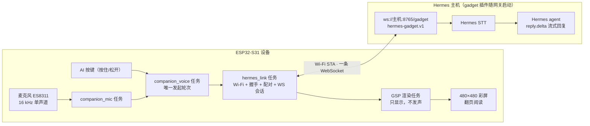
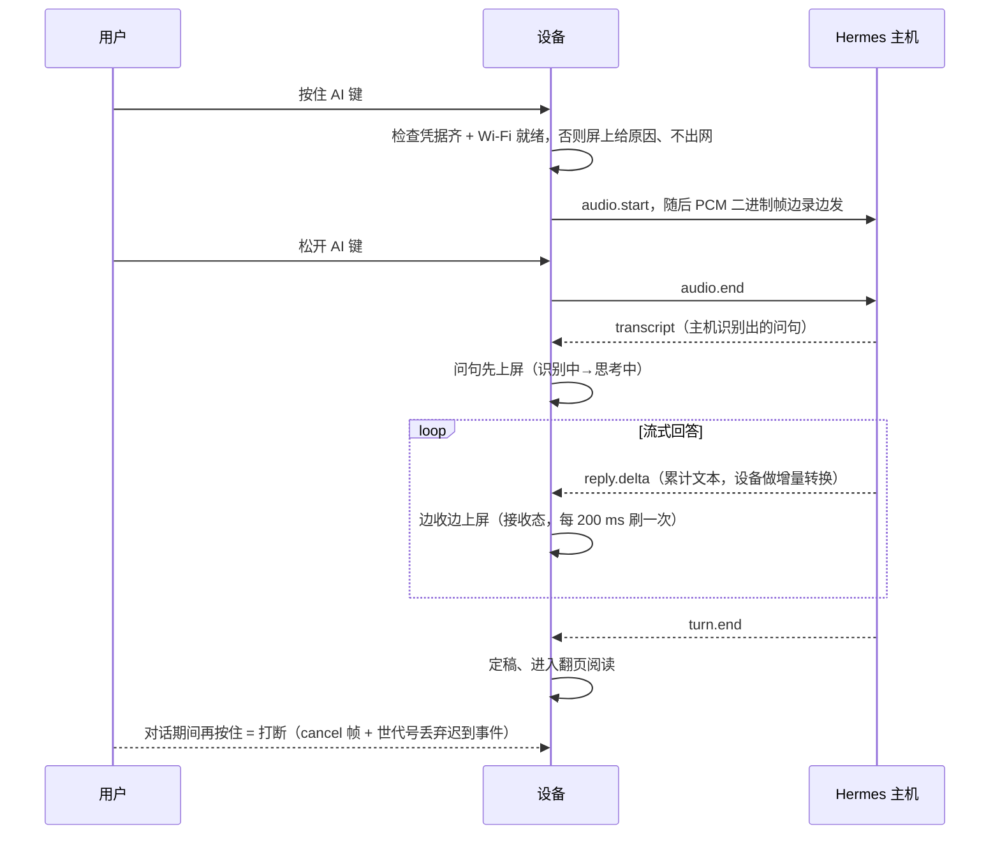
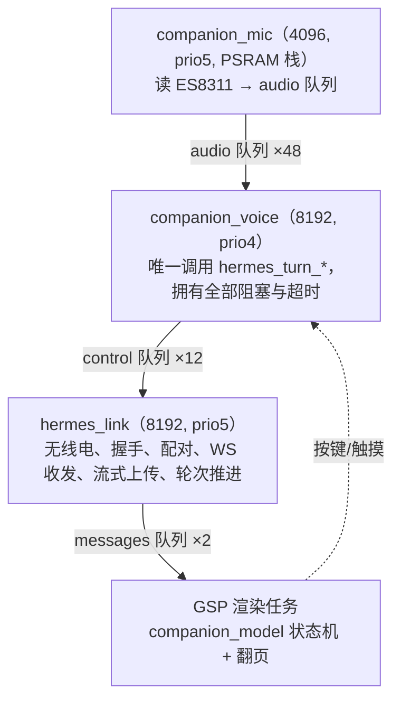
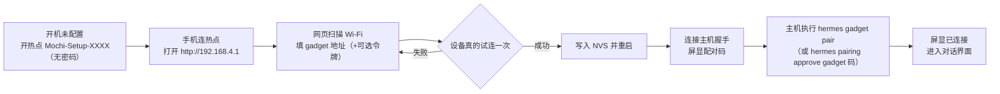

# Hermes Mosaico · ESP-Mosaico 语音 AI 伙伴

接入 [Hermes agent](https://github.com/NousResearch/hermes-agent) 网关的 ESP-Mosaico 语音 AI 伙伴：按住 AI 键说话，音频流式送往 Hermes 主机，由主机完成语音识别，智能体流式回答**只显示在屏幕上，不做任何朗读**，长回答靠页内翻页阅读。支持八种角色动态、中英文界面与手机网页配置。设备身份由首启自动生成的密钥决定，**不需要在设备上填任何账号密码**——首次连接后在主机批准一次配对即可。


[English](README_EN.md) · [手机配置图文教程](docs/SETUP_CN.md) · [构建](docs/BUILDING.md) · [生成角色](docs/CHARACTERS_CN.md) · [项目说明书](docs/PROJECT_MANUAL_CN.md)

上游项目：本仓库由 [Octop-muse-esp-mosaico](https://github.com/samyeei/Octop-muse-esp-mosaico) 改造而来，把后端从自托管 Octop 换成 Hermes agent 的 [gadget 协议](https://github.com/Adolanium/hermes-gadget-sdk)（`hermes-gadget.v1`）。

## 界面预览

下图为模拟器实际渲染（480×480），对话内容为模拟数据：

| 首页 | 识别出的问句 | 翻页阅读 |
|---|---|---|
|  |  |  |
| 状态栏显示 Hermes 连接状态 | 松开按键后先回显识别结果 | 长回答按像素排版分页，可手动或自动翻页 |

## 它是怎么工作的

设备是一块 **ESP32-S31（ESP-Mosaico 裸机）**，配 480×480 QSPI 彩屏 + 电容触摸 + 麦克风，**没有喇叭输出**。识别（STT）、大模型、Markdown 清理全部在 Hermes 主机侧完成，设备端凭据只有两项：**gadget WebSocket 地址**（`ws://主机:8765/gadget`，主机启用 TLS 时为 `wss://`）和**可选的访问令牌**（仅当主机设置了 `GADGET_ACCESS_TOKEN`）。

一句话原理：

> 设备首启生成一把 32 字节设备密钥，身份 `hg-…` 由密钥哈希派生。按住 AI 键期间，16 kHz 单声道 PCM 以二进制帧**边录边发**进同一条 WebSocket（`audio.start` → 二进制 → `audio.end`）；主机识别后回 `transcript`，随后 `reply.delta` 流式上屏、`turn.end` 收尾。断线时录音缓存在 PSRAM 的 30 秒裁剪区，链路恢复后整段重放。所有出网都走设备自己的 Wi-Fi STA，回复只落在屏幕上。

### 架构总览



### 一次对话的端到端时序



### 任务与队列拓扑

运行时是自有的 **3 个任务 + 3 条队列**（详见 [项目说明书 §4](docs/PROJECT_MANUAL_CN.md)）；世代号 `generation` 是并发正确性的唯一来源——迟到的回复/错误因世代不匹配被丢弃。



### 首次配网与配对



保存前设备会真实试连目标网络（最多等 15 s 拿 IP），连不上就整条拒绝、绝不写坏旧凭据。

## 功能

- 黑底奶白色原创角色，待机、聆听、思考、接收、困倦、错误、开心、开机八种动态。
- 上方 AI 键按住说话、松开发送；音频边录边流式上传，主机识别后屏上先出问句、回答再逐字流式上屏；按住 AI 键可打断。
- 屏显每页约 220 个汉字（按像素排版，非按字数），长回答提供手动 `‹ ›` 翻页与自动翻页间隔（3–15 秒）。
- 首次启动连接设备免密码热点 `Mochi-Setup-XXXX`，网页里选 Wi-Fi、填 Hermes 地址；配对码显示在屏幕与设置页，主机批准一次即长期有效。
- 中英文设置；拾音增益、亮度、自动熄屏、翻页间隔可调，设置页底部显示 Hermes 会话状态（连接中/等待配对/在线）。
- 触摸角色触发开心动画，拿起、触摸或按键唤醒熄屏。
- 支持通过同一条 Hermes 通道生成新角色（`{"type":"text"}` 文字轮次），在电脑预览后更新资源。

## 需要准备

ESP-Mosaico 裸机、USB 数据线，以及一个可访问的 Hermes 主机：

1. 安装 [hermes-agent](https://github.com/NousResearch/hermes-agent) **≥ 0.21.6**；
2. 安装 gadget 插件：`hermes plugins install https://github.com/Adolanium/hermes-gadget-sdk/tree/main/plugin --enable`，再 `hermes gateway setup` 选择 "Hermes Gadget"；
3. 主机上 `hermes gadget info` 打印设备通道地址，填进设备配网页。

设备端不需要任何模型 Key——STT 与对话全部由主机完成。每位使用者填写自己的地址，仓库与固件不包含作者的服务地址或 Wi-Fi 数据。当前版本不声明喇叭与 OTA 能力（服务器不会下发音频，固件更新走 mosaico 自己的 `iris system-update`）；不支持视频播放。

## 资源与内存预算

固件把整份 `NotoSansSC` 字体（约 7.4 MB）和 GSP 资源打包进应用，`ota_0` 分区有足够余量；长回答全程驻留 PSRAM 供翻页，不做滚动。

| 项 | 值 | 说明 |
|---|---|---|
| `hermes_companion.bin` | 9,972,464 B | 含字体与资源包 |
| `ota_0` 容量 | `0xaf0000` = 11,468,800 B | 余量约 1.44 MB；应用装进 `ota_0`，不是 `factory` |
| 录音裁剪区 `CLIP_MAX` | 960 KB（30 s × 16000 × 2 B） | PSRAM，超 30 s 丢弃；兼作断线重放缓冲 |
| 链路回复上限 `REPLY_CAP` | 65536 B | 64 KiB，超过截断加省略号 |
| 屏上回复上限 `COMP_REPLY_CAP` | 65536 B | 与链路对齐，约 95 页；超长靠翻页读完 |
| 队列深度 | audio 48 / control 12 / messages 2 | messages 每槽装一整条回答，2 槽已覆盖一次突发 |
| 首帧 / 空闲看门狗 | 45 s / 60 s | 覆盖主机 STT + 模型首字；外层 UI 兜底 120 s |
| 流式刷新 | 每 200 ms 一次 | 读起来是"活的"，又不会出现半页 |
| 心跳 | 服务端每 `heartbeat_s`（默认 20 s）ping | 3× 周期无入帧判死并自动重连 |

> 开机内存基线可在设备日志里读：应用启动时 `companion_runtime_start()` 会打印一行 `runtime start: psram free … internal free …`，用它核对当轮可用堆。

## 直接安装

本仓库**不提供预编译固件**，支持的安装方式是**从源码构建后 system-update**。安装 Python 3.10+ 和 Git，获取代码后在仓库根目录运行：

```powershell
python tools/bootstrap.py
python -m pip install -r requirements.txt
python mosaico.py iris status --all --json
python mosaico.py iris list --project projects/hermes_companion --details --json
```

对首次安装或未验证 Recovery 的设备，先运行 `python mosaico.py recover`，按工具提示操作。已有正常应用和可用 Recovery 时，可通过 `python mosaico.py iris test enter-recovery --project projects/hermes_companion --timeout 35` 进入 Recovery。

自行构建固件（依赖与提交记录见 [DEPENDENCIES.json](DEPENDENCIES.json)，步骤见 [docs/BUILDING.md](docs/BUILDING.md)）：

```powershell
cd projects/hermes_companion
powershell -NoProfile -ExecutionPolicy Bypass -File build_hermes.ps1
```

构建产物用 `python mosaico.py iris system-update --project projects/hermes_companion` 上机（资源或布局变更必须用 `system-update`；仅代码变更且分区表完全一致才可用 `app-update`）。从 Git Bash 运行 mosaico.py 时需要先去掉 `MSYSTEM` 环境变量（`env -u MSYSTEM python mosaico.py …`），否则 idf_tools 会拒绝工作。

首次配置：手机连接屏幕显示的 `Mochi-Setup-XXXX`，无需密码，打开 `http://192.168.4.1`，选 Wi-Fi 并填入 `hermes gadget info` 打印的地址；保存重启后屏幕出现配对码，在主机执行 `hermes gadget pair` 批准即可开始对话。

## 让本地 Agent 帮你安装

把设备通过 USB 数据线连接电脑，打开可访问本机 USB 的 Codex 或其他本地 Agent，直接发送下面这句话：

> 请把本仓库（Hermes-mosaico）的最新版固件安装到我通过 USB 连接的 ESP-Mosaico：阅读仓库说明，先运行 tools/bootstrap.py 准备子模块，再用 projects/hermes_companion/build_hermes.ps1 从源码构建，然后通过 mosaico.py iris system-update 上机，保留设备身份与已有凭据，不要整片擦除 Flash，也不要使用任何历史预编译固件包；安装后检查设备正常启动，并告诉我如何连接设备热点、打开 192.168.4.1 完成首次配置与配对。

Agent 需要本地文件、网络与设备访问能力，可能会提示你授予权限或操作设备进入恢复模式。安装完成后，在手机配置页填写自己的 Hermes 地址，详见 [手机配置图文教程](docs/SETUP_CN.md)。

## 验证与限制

构建、宿主单测与模拟器交互为本仓库的验收口径。协议契约由 `projects/hermes_companion/tools/hermes_probe.py` 对生产版 hub（`hermes-gadget devserver` 同源代码）实测生成，记录在 `tools/hermes_contract.json`；宿主单测把 SHA-256/HMAC/Base64 向量与主机侧 `plugin/protocol.py` 钉死。**尚未在真机 + 真 Hermes 主机上完成端到端验收**（等主机到位后补 30 轮回归）；开发期用 devserver 走通了配对、语音、打断、重连全链路。模拟器不会联网，也不会发声。模型首包取决于主机配置，设备给 45 秒首字等待和 60 秒流空闲窗口，超时会在屏上给出原因。完整限制清单见 [项目说明书](docs/PROJECT_MANUAL_CN.md)。

## 开源与依赖

应用源码采用 Apache-2.0，第三方代码和字体保留各自许可证，见 [NOTICE](NOTICE)。后端为 [Hermes agent](https://github.com/NousResearch/hermes-agent)（gadget 协议参照 [hermes-gadget-sdk](https://github.com/Adolanium/hermes-gadget-sdk)，MIT）；平台底座是 [ESP-Mosaico Vibe](https://github.com/esp-mosaico/esp-mosaico-vibe)。早先版本的 Muse Gadget SDK 源码保留在 `projects/hermes_companion/vendor/` 仅作回退参考，已不参与构建。内部固件工程名为 `hermes_companion`。

特别致谢： https://linux.do 社区
