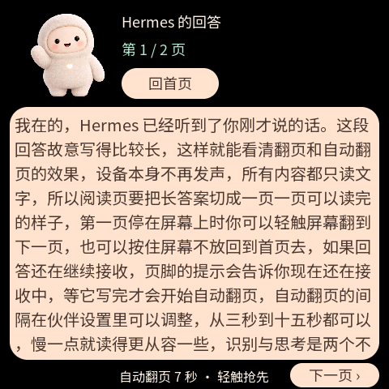
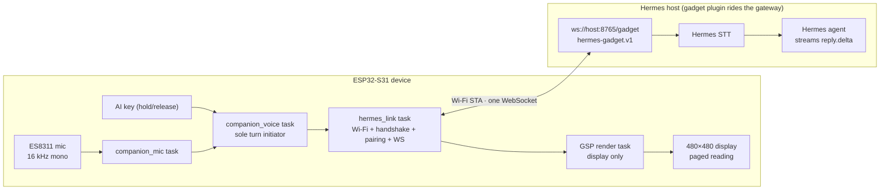

# Hermes Mosaico · ESP-Mosaico voice AI companion

An ESP-Mosaico voice AI companion wired into a [Hermes agent](https://github.com/NousResearch/hermes-agent) gateway: hold the AI key and speak — audio streams to the Hermes host, which does the speech recognition — and the agent's streaming reply is **shown on screen only, never spoken**. Long answers are read page by page. Eight character animations, bilingual UI, phone-web provisioning. Device identity is a key generated on first boot; **no account or password is ever typed on the device** — approve one pairing code on the host and you are done.


[中文](README.md) · [Setup guide (CN)](docs/SETUP_CN.md) · [Building](docs/BUILDING.md) · [Characters (CN)](docs/CHARACTERS_CN.md) · [Project manual (CN)](docs/PROJECT_MANUAL_CN.md)

Upstream: this repository was adapted from [Octop-muse-esp-mosaico](https://github.com/samyeei/Octop-muse-esp-mosaico); the backend was swapped from self-hosted Octop to the Hermes agent's [gadget protocol](https://github.com/Adolanium/hermes-gadget-sdk) (`hermes-gadget.v1`).

## Screens

Rendered by the simulator at 480×480; conversation text is mock data:

| Home | Recognized question | Paged reading |
|---|---|---|
|  |  |  |
| Status bar shows the Hermes link state | The transcript is shown right after release | Long answers paginate by pixel budget |

## How it works

The device is an **ESP32-S31 (bare ESP-Mosaico)** with a 480×480 QSPI display, capacitive touch and a microphone, and **no speaker**. Speech recognition, the model and Markdown cleanup all live on the Hermes host. The device holds exactly two settings: the **gadget WebSocket URL** (`ws://host:8765/gadget`, `wss://` when the host has TLS) and an **optional access token** (only when the host sets `GADGET_ACCESS_TOKEN`).

One-sentence principle:

> On first boot the device generates a 32-byte key; its identity `hg-…` is derived from that key. While the AI key is held, 16 kHz mono PCM is **streamed live** over the single WebSocket (`audio.start` → binary frames → `audio.end`); the host recognizes the speech, returns a `transcript`, then streams `reply.delta` snapshots to the screen and closes with `turn.end`. If the link drops mid-recording, the clip keeps growing in a 30-second PSRAM buffer and replays in full once the link is back.

### Architecture



### First provisioning and pairing

1. Fresh boot opens the `Mochi-Setup-XXXX` hotspot; the phone joins and opens `http://192.168.4.1`.
2. Pick Wi-Fi, paste the gadget URL from `hermes gadget info` (+ token if the host uses one). The device **test-joins the network before saving anything**.
3. After reboot the device handshakes with the host and shows a **pairing code**; approve it once with `hermes gadget pair` (or `hermes pairing approve gadget <CODE>`).
4. The screen says "Hermes online"; pairing persists across reboots and Wi-Fi changes.

## Features

- Eight original character animations (idle, listening, thinking, receiving, sleepy, error, happy, boot).
- Hold the AI key to talk; audio streams while you speak, the transcript appears first, then the reply streams onto the screen; press again to interrupt.
- About 220 hanzi per reading page (pixel-budgeted, proportional font), manual `‹ ›` paging plus an auto-page interval (3–15 s).
- Bilingual settings: mic gain, brightness, screen sleep, page interval; the settings footer shows the live Hermes session state (connecting / awaiting pairing + code / online).
- New characters can be generated through the same Hermes channel (`{"type":"text"}` turns) and previewed on a PC.

## What you need

An ESP-Mosaico board, a USB cable, and a reachable Hermes host:

1. Install [hermes-agent](https://github.com/NousResearch/hermes-agent) **≥ 0.21.6**;
2. Install the gadget plugin: `hermes plugins install https://github.com/Adolanium/hermes-gadget-sdk/tree/main/plugin --enable`, then `hermes gateway setup` and pick "Hermes Gadget";
3. `hermes gadget info` prints the device URL to paste into the setup page.

No model keys live on the device — STT and chat are entirely host-side.

## Resource budget

| Item | Value | Notes |
|---|---|---|
| `hermes_companion.bin` | 9,972,464 B | fonts + GSP assets included |
| `ota_0` capacity | `0xaf0000` = 11,468,800 B | ~1.44 MB headroom; the app lives in `ota_0`, not `factory` |
| Recording clip `CLIP_MAX` | 960 KB (30 s × 16000 × 2 B) | PSRAM; doubles as the disconnect replay buffer |
| Reply cap `REPLY_CAP` | 65536 B | truncated with an ellipsis beyond that |
| Queue depths | audio 48 / control 12 / messages 2 | each message slot carries a whole answer |
| First frame / idle watchdog | 45 s / 60 s | covers host STT + first token; 120 s outer UI ceiling |
| Streaming refresh | every 200 ms | reads as live, never shows a half page |
| Heartbeat | server `ping` every `heartbeat_s` (default 20 s) | 3× silent ⇒ drop and reconnect |

## Installing

No prebuilt firmware ships with this repository. From source (Python 3.10+, Git):

```powershell
python tools/bootstrap.py
python -m pip install -r requirements.txt
cd projects/hermes_companion
powershell -NoProfile -ExecutionPolicy Bypass -File build_hermes.ps1
```

Flash with `python mosaico.py iris system-update --project projects/hermes_companion` (run from PowerShell, or strip `MSYSTEM` first when starting from Git Bash — `idf_tools.py` refuses to run under MSYS). First installs or devices without a verified Recovery start with `python mosaico.py recover`. See [BUILDING](docs/BUILDING.md) for the host checks (credentials/URL/JSON/crypto unit tests and the model state-machine test) and the protocol contract probe.

## Validation and limits

Build, host unit tests and simulator captures are this repository's acceptance bar. The protocol contract was recorded live against the production hub code (`tools/hermes_probe.py` → `tools/hermes_contract.json`), and the crypto vectors in the host tests are generated from the server's own `plugin/protocol.py`. **End-to-end validation on physical hardware against a real Hermes host is still pending** (a 30-turn regression will run once the host is available); during development the full pairing/voice/interrupt/reconnect path ran against `hermes-gadget devserver`. The simulator never goes online and never plays audio. First-token latency depends on the host's model; the device waits 45 s for the first frame and 60 s between frames, then explains itself on screen. Full limitation list in the [project manual](docs/PROJECT_MANUAL_CN.md).

## License

Application sources: Apache-2.0; third-party code and fonts keep their licenses — see [NOTICE](NOTICE). Backend: [Hermes agent](https://github.com/NousResearch/hermes-agent); protocol reference [hermes-gadget-sdk](https://github.com/Adolanium/hermes-gadget-sdk) (MIT); platform base [ESP-Mosaico Vibe](https://github.com/esp-mosaico/esp-mosaico-vibe). The retired Muse Gadget SDK copy under `projects/hermes_companion/vendor/` is kept for reference only and stays outside the build graph.
